# FieldNote: features, integrations and user flows

This guide covers everything integrated into FieldNote, with a separate flow for each user group and one end-to-end story. All diagrams are Mermaid; they render on GitHub, in VS Code (with a Mermaid extension) and in most Markdown viewers.

**Related docs**
- `PRODUCTION_GAPS.md`: the audit and its current status.
- `DEPLOYMENT.md`: configuration and release.
- `SECRETS_AND_EXTERNAL_SERVICES.md`: keys and external providers.

**Contents**
1. [What FieldNote is](#1-what-fieldnote-is)
2. [System and integrations](#2-system-and-integrations)
3. [Sponsor flow](#3-sponsor-flow)
4. [Volunteer flow](#4-volunteer-flow)
5. [Account, consent and trust flow](#5-account-consent-and-trust-flow)
6. [State machines](#6-state-machines)
7. [Online and offline behaviour](#7-online-and-offline-behaviour)
8. [End-to-end story: Priya and Arjun](#8-end-to-end-story-priya-and-arjun)
9. [Rules and limits](#9-rules-and-limits)

---

## 1. What FieldNote is

FieldNote turns a sponsor's intent ("clean up the lake on Sunday") into a funded, staffed, evidence-backed local campaign. There are exactly two roles, chosen at signup and locked afterwards:

| Role | Does | Never sees |
|---|---|---|
| **Sponsor** | Creates campaigns with AI, pins a location, funds campaigns through Razorpay, invites volunteers, watches live impact, reviews evidence, handles cancel/postpone/revise | Names or locations of volunteers who haven't joined (only anonymous groups of 3 or more) |
| **Volunteer** | Publishes availability, gets AI-ranked matches, joins, travels, checks in inside a 200 m geofence, submits photo + note + summary, sees their history | Other volunteers' identities; payment details |

---

## 2. System and integrations

### 2.1 Architecture

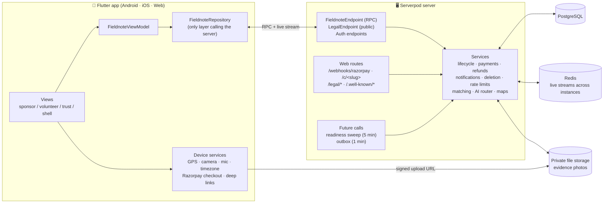

### 2.2 External integrations

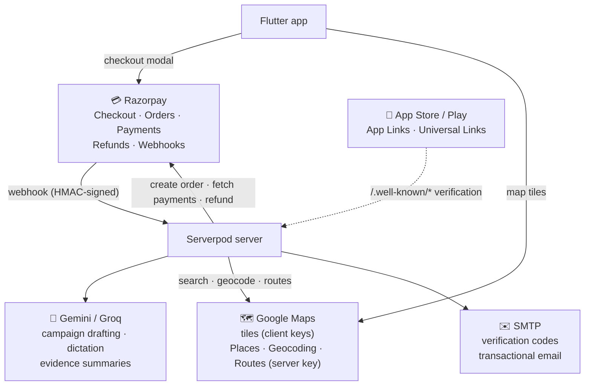

| Integration | Used for | If it is missing or down |
|---|---|---|
| **Razorpay** | Sponsor payments, refunds, webhook settlement | Checkout can't open. Funding never changes without server-side HMAC verification. Stuck orders are reconciled by the sweep. |
| **Gemini / Groq** (via `ai_provider_router`) | Campaign drafts from a brief, voice dictation, evidence summaries | Sponsors use the manual form. Volunteers write the summary themselves (`manualSummary`). Completion is never blocked. |
| **Google Maps** | Map tiles, place search, geocoding, travel time | Maps show a coordinate fallback panel. The geofence uses the server's own maths and never needs Google. |
| **SMTP** | Signup/reset codes, notifications | Business actions still succeed. Emails wait in the outbox and are retried. |
| **Redis** | Live campaign streams across server instances | Streams only reach clients on the same instance. |
| **Private storage** | Evidence photos (unique path per upload) | Upload fails with a clear error; it is safe to retry. |
| **Store link verification** | Opening `https://<host>/c/<slug>` in the app | Links open the web share page instead. |

### 2.3 Background jobs (they run while users are offline)

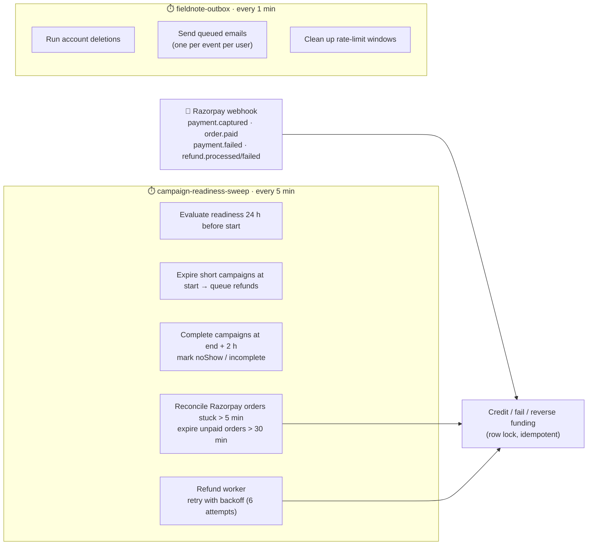

---

## 3. Sponsor flow

### 3.1 Overview

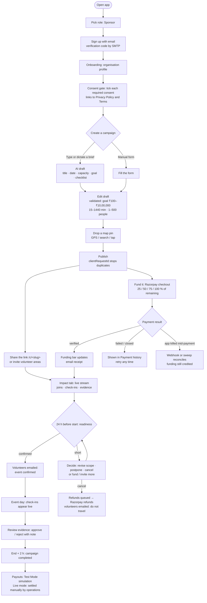

### 3.2 Payment sequence (online, with failure safety)

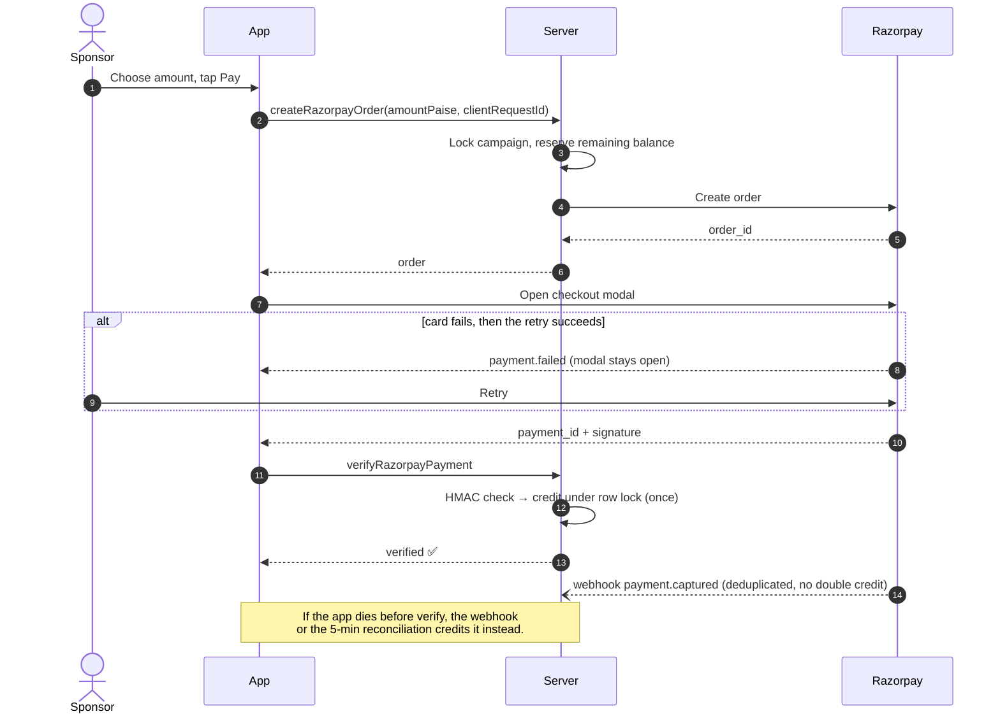

### 3.3 Sponsor screens

| Tab / screen | What you do there |
|---|---|
| **Discover** | Browse open campaigns, fund any of them |
| **Create** | Brief → AI draft → edit → pin → publish |
| **Impact** | Your created *and* funded campaigns (any status), live indicator, metrics, evidence tiles, payment history button |
| **Readiness** | Revise scope, postpone, cancel (only before start), open checkout, copy invite link |
| **Volunteer reach** | Joined volunteers by name; everyone else as "N volunteers in this area", with "Invite area" |
| **Payouts** | Refund list; simulate payout (Test Mode, after completion) or the manual-settlement notice |
| **Payment history** | Verified / failed / pending / refund queued / refunded |
| **Post update** | Campaign updates volunteers can read |

---

## 4. Volunteer flow

### 4.1 Overview

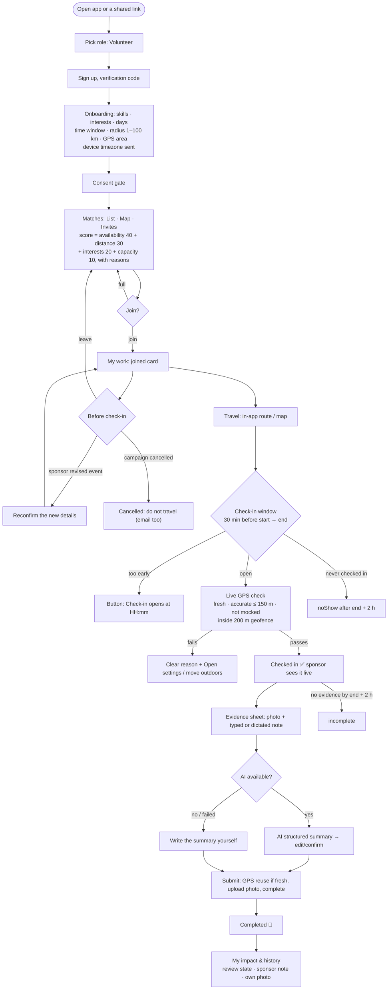

### 4.2 Check-in and evidence sequence

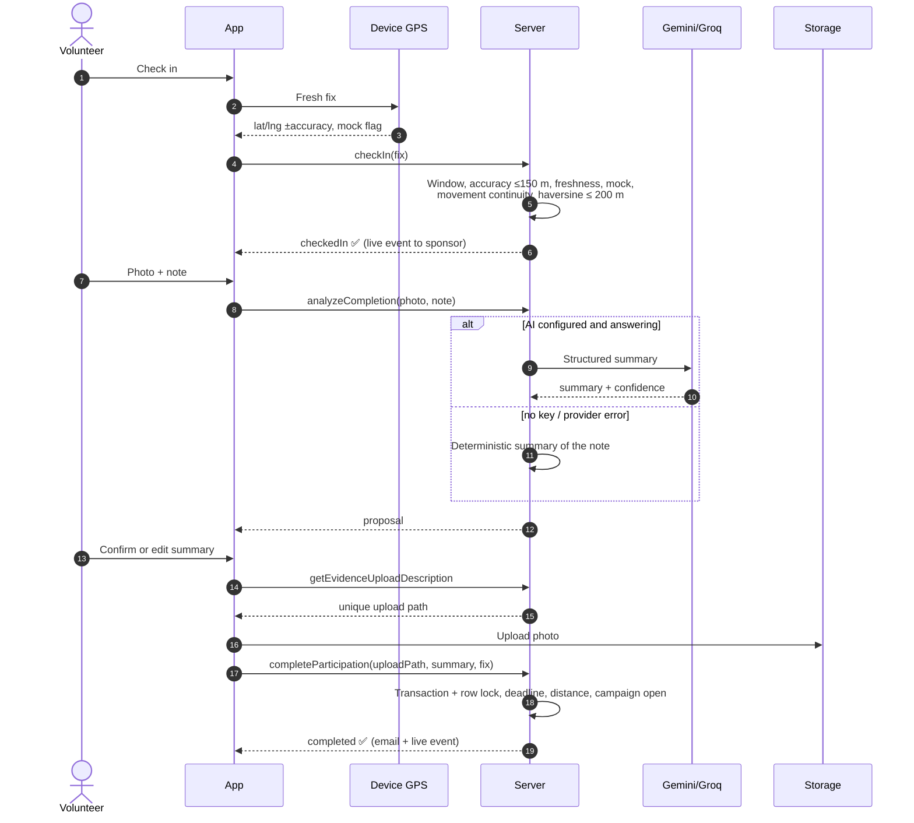

### 4.3 Volunteer screens

| Screen | What you do there |
|---|---|
| **Matches** (List / Map / Invites) | Ranked campaigns with reasons; "Full" campaigns can't be joined |
| **My work** | Joined cards with status, check-in window chip, leave, check in, submit; "Past and closed" section |
| **Availability** | Days, time window, radius, area (live GPS, search or pin), "I can help today" (expires daily) |
| **Evidence sheet** | Photo, note (type or dictate), AI or self-written summary, upload progress |
| **My impact & history** | Every participation, review state, sponsor note, own evidence photo |
| **Shared campaign** | Opened from `/c/<slug>` links, even when logged out (it opens after sign-in) |

---

## 5. Account, consent and trust flow

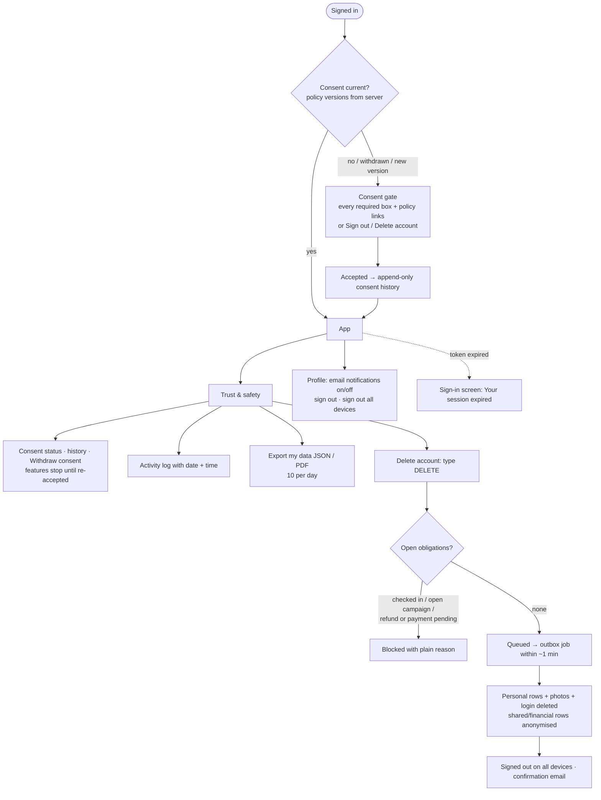

---

## 6. State machines

### 6.1 Campaign

`status` (draft · active · completed) combined with `readinessState`:

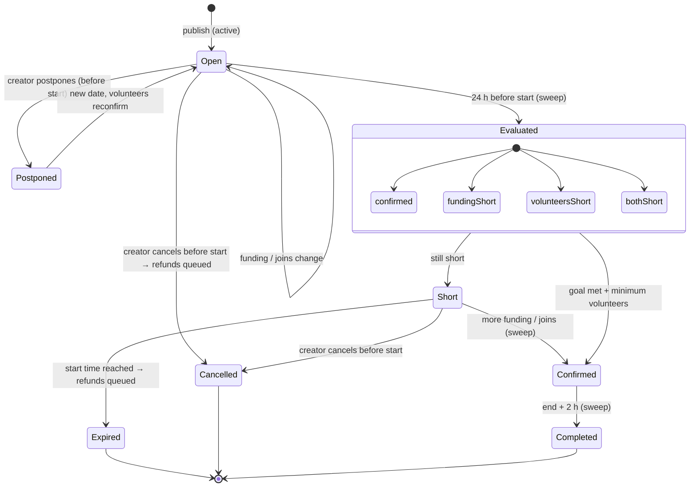

### 6.2 Participation

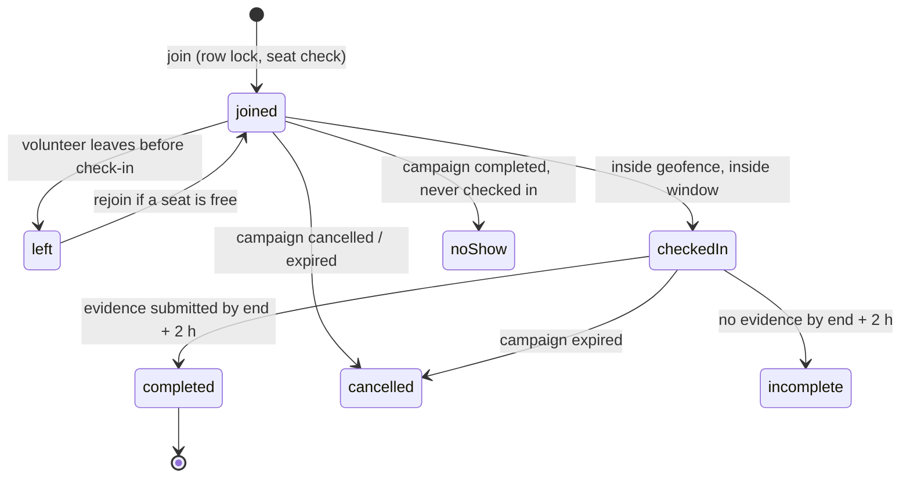

### 6.3 Payment and refund

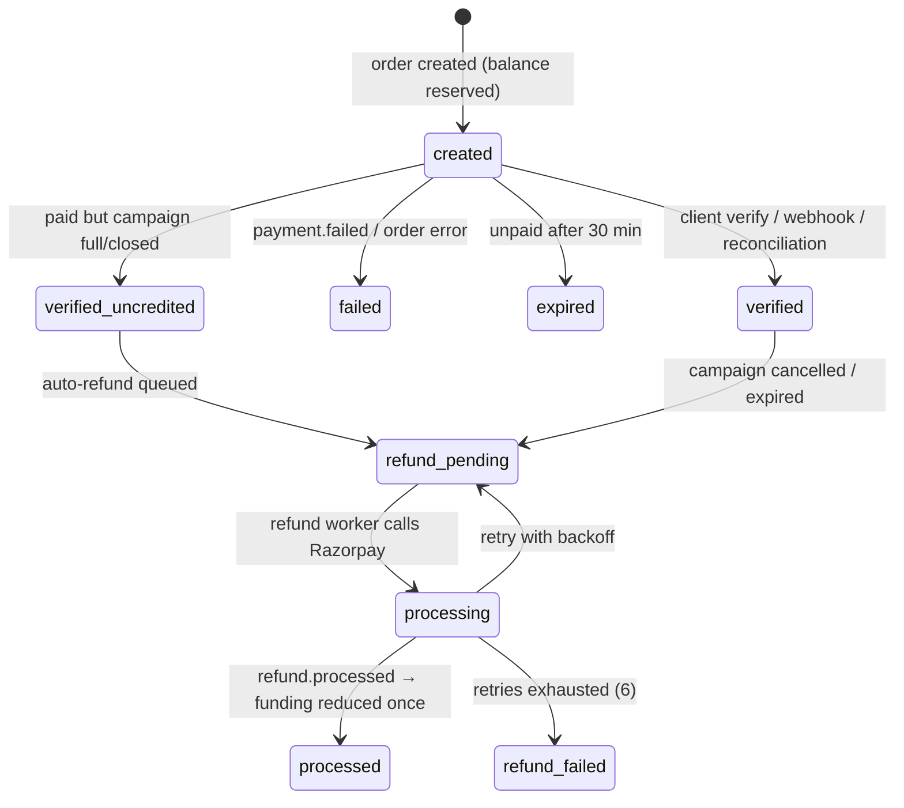

Evidence review: `pending → approved` or `pending → rejected (note required)`. Rejected evidence is excluded from impact totals.

---

## 7. Online and offline behaviour

FieldNote is **online-first**. Every action is validated by the server: payments, geofence, seats and deadlines. The app does **not** queue actions while offline. The earlier offline outbox was removed because it stored photos insecurely and could replay one user's captures for another. What keeps working while you're offline is the background work on the server (§2.3).

### 7.1 Connectivity states in the app

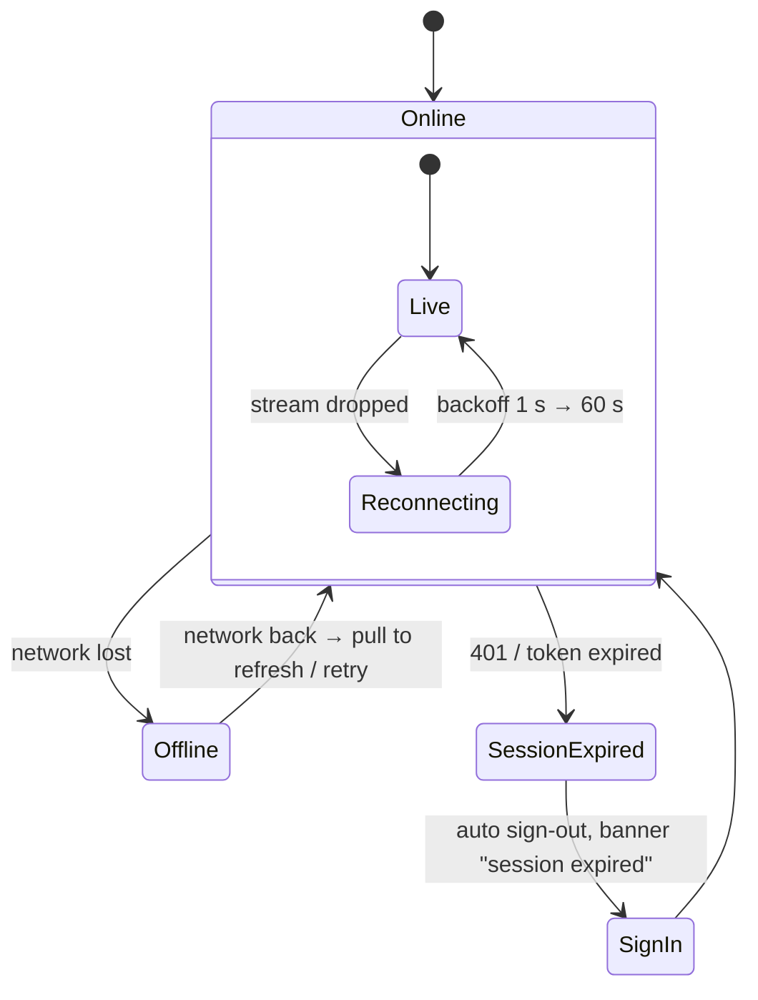

### 7.2 What happens offline, feature by feature

| Feature | Online | Offline / weak network |
|---|---|---|
| Sign in / sign up | Email code via SMTP | Can't sign in; friendly "Can't reach FieldNote" |
| Pending role choice | Saved on the device | Kept on the device; cleared on sign-out |
| Shared link `/c/<slug>` | Opens the campaign | Remembered in memory and opened after sign-in (lost if the app is killed) |
| Browse matches / campaigns | Live data | Last loaded screen stays visible; refresh fails with an "You're offline" notice |
| Create / publish campaign | AI draft, publish | Draft stays in the form; publish fails safely. Retry reuses the same `clientRequestId`, so no duplicate |
| Pay (Razorpay) | Checkout → verify | Can't open checkout. **If the connection drops after paying**, the webhook or the 5-min reconciliation credits it |
| Live impact stream | Real-time events | Shows "Reconnecting…", reconnects automatically |
| Check in | Server geofence check | Not possible offline (server must verify location) |
| Evidence submit | Upload + complete | Fails with a clear error. Retry is safe (unique path, idempotent completion) **until end + 2 h** |
| Dictation / AI summary | AI | Volunteer can type the summary themselves |
| Maps | Google tiles | Coordinate fallback panel |
| Emails | Sent by the outbox | Queued on the server and sent when SMTP is reachable |
| Refunds | Worker → Razorpay | Retried with backoff; the user needn't be online |
| Account deletion | Request → queued | Runs on the server within ~1 min; user can be offline |

### 7.3 Online vs offline, end to end

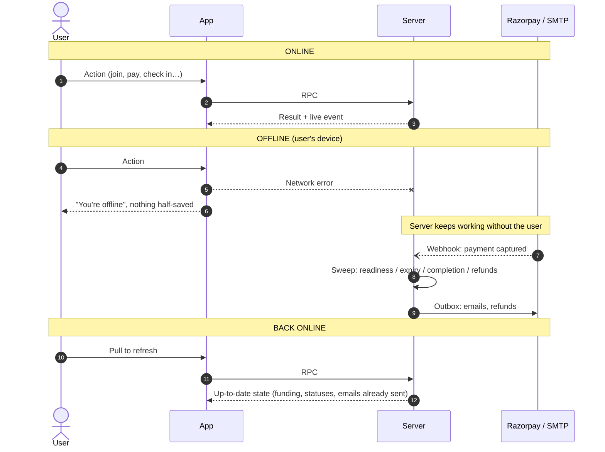

---

## 8. End-to-end story: Priya and Arjun

> **Characters (made up)**
> - **Priya Nair**, *Sponsor*, coordinator at "Green Pune Trust".
> - **Arjun Kulkarni**, *Volunteer*, engineering student in Pune.
> - **Meera**, *Volunteer*, Arjun's classmate.
> - **Campaign:** "Pashan Lake shoreline clean-up", Sunday 08:00–10:00 IST. Goal ₹25,000, capacity 20, minimum 6 volunteers.

### 8.1 Timeline

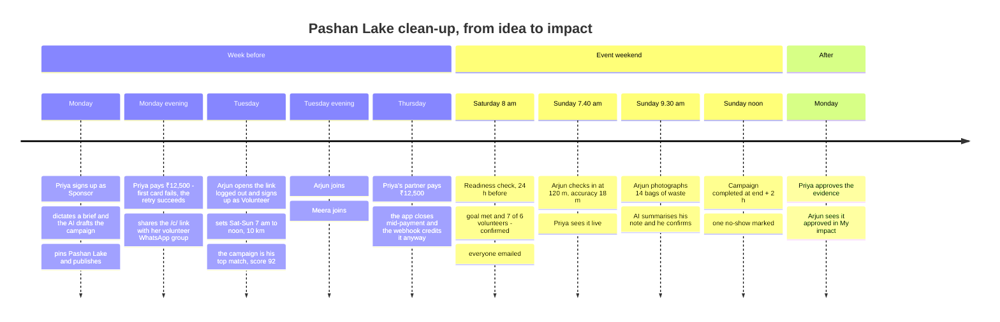

### 8.2 The story, step by step

**Monday: Priya creates and funds**

1. Priya installs FieldNote, picks **Sponsor**, signs up and enters the code from her email.
2. **Consent:** she ticks location, AI processing and evidence sharing, and opens the Privacy Policy link.
3. In **Create** she taps the mic and says: *"Lake clean-up at Pashan this Sunday morning, about 20 people, we need gloves and bags."*
4. **AI draft:** Gemini drafts the title, Sunday 08:00 (in her timezone), 120 minutes, capacity 20 and a checklist. She sets the goal to "25,000", which the app parses as 2,500,000 paise.
5. **Publish:** she drops the pin on the shoreline and taps Publish. The network blips and she taps again. The second request carries the same `clientRequestId`, so the server returns the same campaign instead of a duplicate.
6. **First payment:** she funds 50% (₹12,500). Her first card is declined *inside* the Razorpay modal and she retries with UPI. The modal stays open through the failure, so the success is verified and credited. Before this fix, that payment was silently lost on web.
7. She copies the invite: the message includes `https://<host>/c/k3J9…`, an unguessable link.

**Tuesday: Arjun discovers and joins**

8. Arjun taps the link while logged out. The app remembers it, he signs up as **Volunteer**, and after onboarding and consent it opens the campaign automatically.
9. **Onboarding:**
   - **Availability:** Sat/Sun, 07:00–12:00.
   - **Travel:** 10 km.
   - **Interests:** environment.
   - **Area:** live GPS.
   - **Timezone:** the app sends `Asia/Kolkata`, so matching uses his local time.
10. **Match score 92:** availability 40 (the window holds the whole event), distance 28 (4 km), interests 20 and capacity 4 (the campaign is already well staffed), each shown as a reason.
11. **Join:** Arjun joins. Priya's Impact tab streams "A volunteer joined", with no name, because live streams never carry names. In **Volunteer reach** she sees Arjun by name, since he joined. People nearby who haven't joined only appear as "5 volunteers in this area", and she taps **Invite area**.

**Thursday: an interrupted payment**

12. **Second payment:** Priya's partner pays the remaining ₹12,500, then the phone dies before the app can call verify.
13. **Webhook:** Razorpay sends `payment.captured`. The server checks the HMAC, deduplicates the event and credits it under a row lock. The funding bar reaches 100% the next time anyone opens the app. Had the webhook been delayed, the 5-minute reconciliation would have credited it instead.

**Saturday 08:00: the readiness check**

14. **Confirmed:** 24 hours before the start, the sweep evaluates the campaign. The goal is met and 7 volunteers have joined (minimum 6), so it is **confirmed**. All 7 get an email showing the time in their own timezone (08:00 IST).
15. **A volunteer leaves:** one volunteer realises they can't come and taps **Leave campaign**. The seat is freed and readiness recounts.

**Sunday: the event**

16. **Too early:** at 07:20 Arjun's button reads "Check-in opens at 07:30".
17. **Check-in:** at 07:40 he checks in from 120 m away with ±18 m accuracy, a fresh fix and no mock flag. The server's haversine check passes and Priya sees "checked in" live.
18. **Weak GPS:** Meera is under trees with ±210 m accuracy. The app warns "GPS accuracy is ±210 m; FieldNote needs 150 m or better. Move outdoors." She steps into the open and checks in.
19. **Evidence:**
    - **Photo and note:** at 09:30 Arjun photographs the bags and dictates *"Fourteen bags, mostly plastic, two broken bottles near the boat jetty."*
    - **Summary:** the AI structures it and he edits one word and confirms.
    - **Submit:** his 60-second-old tracking fix is reused and the photo uploads to a unique private path. Completion runs in a locked transaction.
20. **AI fallback:** if the AI provider had been down, Arjun would have seen "Write the summary myself" and submitted with `manualSummary`. Nothing would have blocked him.
21. **Weak network at submit:** the upload fails at the lake and he sees a clear error. Back on 4G ten minutes later he retries, which is safe because it's well before the 12:00 deadline.

**Sunday 12:00: completion**

22. **Completed:** at end + 2 h the sweep marks the campaign **completed**. The one volunteer who joined but never checked in becomes **noShow**. Anyone who checked in without submitting would become **incomplete**.

**Monday: review and history**

23. **Review:** Priya opens Arjun's evidence tile. It shows the provenance (GPS, time, "AI-drafted summary") and she taps **Approve**. Arjun gets an email.
24. **Arjun's history:** in **My impact & history** he sees "Completed · Approved · Pashan Lake", with his photo.
25. **Payouts:** in Test Mode, Priya can simulate the payout now that the campaign is completed. With live keys she sees "Payouts are settled manually by FieldNote operations".

### 8.3 The other branch: if the campaign falls short

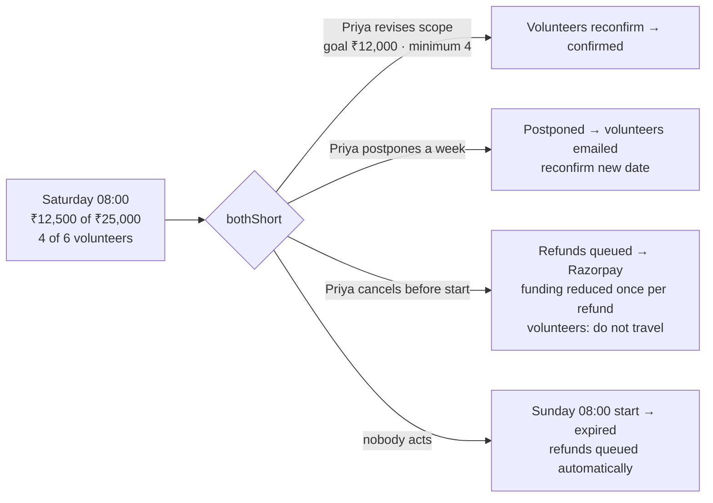

### 8.4 Later: Arjun deletes his account

26. **Blocked:** Arjun requests deletion while checked in to another campaign. He sees "You're checked in to a campaign. Finish or wait for it to close first."
27. **Deleted:** after it closes he types DELETE.
    - Within about a minute the outbox job deletes his availability, consent row, invitations, evidence photos and login.
    - His past participation stays as an anonymous record, so Priya's impact totals don't change.
    - He is signed out everywhere and gets a confirmation email.

---

## 9. Rules and limits

| Rule | Value |
|---|---|
| Matching weights | availability 40 · distance 30 · interests 20 · capacity 10 |
| Geofence | 200 m (server haversine); GPS accuracy ≤ 150 m; fix freshness ≤ 2 min; mock locations rejected |
| Check-in window | 30 min before start → end |
| Evidence deadline / completion | end + 2 h |
| Readiness decision | evaluated from 24 h before start; expires at start if still short |
| Campaign limits | goal ₹100–₹10,00,000 · 15–1440 min · capacity 1–500 · title 3–120 · description 10–4000 |
| Availability | weekdays 1–7 (≥ 1) · start < end · radius 1–100 km; "I can help today" expires at local midnight |
| Text limits | display name 80 · notes/posts 2000 · interests/skills 20 × 40 chars |
| Money | stored as integer paise; ₹ shown with Indian grouping |
| Reconciliation | orders unpaid > 5 min checked with Razorpay; > 30 min expired |
| Refund retries | up to 6, exponential backoff |
| Live stream reconnect | backoff 1 s → 60 s |
| Volunteer privacy | non-joined volunteers only in anonymous groups of ≥ 3 |
| Rate limits (per user) | AI drafts 20/h · dictation 30/h · evidence analysis 20/h · maps 600/h · matches 240/h · orders 20/h · share/invite 60/h · deletion requests 5/day · data export 10/day |
| Account deletion | refused while checked in, running an open campaign, or with a pending refund/payment; otherwise done in ~1 min |
| Languages / themes | English, Hindi, Tamil (hi/ta pending native review) · light and dark (system) |
